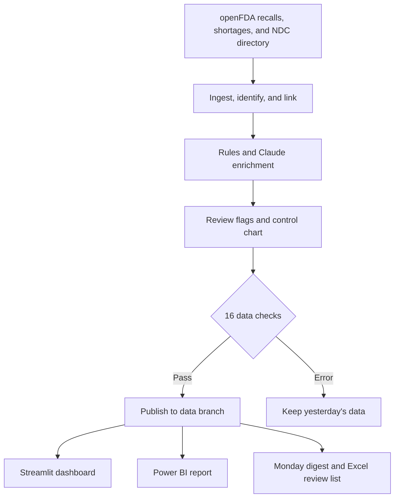

# ShortageSignal

**Daily FDA recall monitoring, drug-shortage links, and AI-assisted review.**

ShortageSignal turns public FDA recall, shortage, and drug-directory data into a daily review workflow. It identifies recalled drugs, links them to shortage listings, classifies root causes, and publishes checked data to a live dashboard, Power BI, and a weekly digest.

**[Open the dashboard](https://shortagesignal.streamlit.app)** · [Explore the findings](#what-the-data-shows) · [Review AI evaluations](#how-the-ai-was-tested) · [Run locally](#run-locally)

| Operational coverage | Data protection | AI-assisted identification |
| :--- | :--- | :--- |
| Runs daily at **12:00 UTC** on GitHub Actions | **16 data checks** before saving, with the last successful dataset retained on errors | Drug-name coverage increases from **56% to 83%** |

`Python` · `SQL` · `DuckDB` · `Claude Haiku` · `Streamlit` · `Power BI` · `GitHub Actions`

## Explore the outputs

| Output | What you can review |
| :--- | :--- |
| **[Streamlit dashboard](https://shortagesignal.streamlit.app)** | Recent flags, weekly recall control charts, and what follows a recall. **Ask the data** generates one read-only SQL query and answers from the returned rows, with the query visible. This tab is passcode-protected. |
| **[Power BI report](reports/powerbi/)** | Open `shortagesignal.pbip` in Power BI Desktop and select **Refresh** to pull the latest data from GitHub. |
| **Monday digest** | A GitHub issue labeled `digest`, accompanied by an Excel list of items requiring human review. |


## What the data shows

**Snapshot: Nov 2, 2026.** The dashboard contains the latest numbers. These are observed links in public data, not evidence that a recall caused a shortage.

| Finding | Evidence and interpretation |
| :--- | :--- |
| **A shortage following a recall is uncommon in this dataset.** | Of **3,639** drugs recalled since **2020**, counting each drug once per recall event, **45 (1.2%)** were followed within a year by a shortage of the same drug that FDA still lists. |
| **Injectables show the most consistent association.** | **1.9%** of recalled injectables were followed by a shortage within a year, compared with **0.9%** of other drugs. The difference appears in both **2020-22** and **2023** onward. |
| **Sterility adds no separation within injectables.** | Sterile injectables and other injectables both reach **1.9%**. The broader sterility association reflects the concentration of injectables among sterility recalls. |
| **Few listed manufacturers did not imply more observed shortages.** | Drugs listed by only **1 or 2** companies had fewer observed shortages. Many are niche or compounded products that FDA's shortage list rarely covers. |
| **Link strength and repeat shortages matter.** | **32 of the 45** rely on the loosest link: the same drug from any company. **5** repeatedly short drugs, including fentanyl and atropine, account for **20** of the links. |

### An analysis correction that changed the conclusion

An earlier version counted recall events instead of individual drugs. That made sterility look **3 times** riskier than average and the first risk flag **4 times** riskier. Counting each drug separately reduced sterility to about **1.3 times** and the flag's high level to **zero**. The [decision log](docs/decision_log.md) explains how the issue was found and why the analysis changed.

## How the pipeline works

1. **Ingest and preserve history.** Pull the last **60 days** of openFDA recalls, merge by recall number with a full edit history, save a dated shortage snapshot, and refresh the NDC directory weekly.
2. **Identify and link drugs.** Use NDC codes, FDA annotations, and product text. Links have four strengths: same package, same product, same drug and company, or same drug.
3. **Resolve missing names with Claude Haiku.** Use a suggested drug name only when confidence is sufficient and the drug is known to exist. Identification coverage rises from **56% to 83%**.
4. **Classify root causes.** SQL rules tag **99%** of recalls. Claude handles unresolved cases within **12 categories** enforced by a tool schema.
5. **Surface review priorities.** Flag a recall **high** when its drug is already on the shortage list and **watch** when it is an injectable. Track weekly recall events against a normal range.
6. **Validate before publishing.** Run **16 data checks**. Errors retain yesterday's data, while warnings flag the run.
7. **Publish shared outputs.** Save every table to the `data` branch for the dashboard, Power BI report, and Monday digest.



## How the AI was tested

Claude's three jobs were evaluated against human-written answers: an initial **99-recall** hand audit used during tuning, followed by **30 fresh recalls** labeled blind.

| Job | Initial audit, used for tuning | Fresh labels |
| :--- | :--- | :--- |
| Root causes, rules | 99 of 99 | 18 of 20 |
| Root causes, Claude on unresolved cases | Not tested | 5 of 9 |
| Drug names, Claude, ignoring salts | 70 of 74 | 14 of 15 |
| Ask the data | 17 of 18 test questions | Not reported |

The fresh-label results provide the more useful check of generalization, and the samples are small. [AI evaluation notes](docs/ai_evals.md) include the **9 drug labels** corrected openly and the chatbot's first live question that returned a wrong answer.

## Run locally

Open the repository in **GitHub Codespaces** for the setup in `.devcontainer/`, or use **Python 3.10+** locally:

```bash
git clone https://github.com/Showrish/shortagesignal.git
cd shortagesignal
pip install -e ".[dev]"
pip install -r app/requirements.txt

git fetch origin data
mkdir -p data
git archive origin/data | tar -x -C data

pytest
python -m shortagesignal.ingest
SHORTAGESIGNAL_DATA=local streamlit run app/streamlit_app.py
```

The documented test suite contains **124 tests**. A local pipeline run leaves Claude off by default. The normal automated run costs a fraction of a cent a day. See the [runbook](docs/runbook.md) for keys, settings, other commands, and recovery steps.

## Documentation

| Doc | What's in it |
|---|---|
| [Runbook](docs/runbook.md) | What runs when, keys and settings, rerunning a day, what each data check means and what to do |
| [Data dictionary](docs/data_dictionary.md) | Every file and column, built from the data itself |
| [AI evals](docs/ai_evals.md) | How Claude's three jobs were tested, and what the scores mean |
| [Limitations](docs/limitations.md) | What the data leaves out, where it can be wrong, how far the findings go |
| [Decision log](docs/decision_log.md) | Every choice and why, including the ones that were reversed |
| [Git workflow](docs/git_workflow.md) | Issues, branches, pull requests and CI |

## Stack and repository

Python, SQL on DuckDB, Parquet, GitHub Actions, Claude Haiku through the Anthropic API with tool use, Streamlit, Power BI, openpyxl, pytest, and ruff.

`main` is protected. Changes go through an issue, a branch, and a pull request that must pass CI. Work is planned in four batches, each tracked as an Issues milestone.

| Path | Purpose |
| :--- | :--- |
| [`src/shortagesignal/`](src/shortagesignal/) | Ingestion, identification, matching, extraction, tagging, flags, checks, digest, and Ask the data |
| [`sql/`](sql/) | Root-cause rules and analysis queries |
| [`app/`](app/) | Streamlit dashboard |
| [`reports/powerbi/`](reports/powerbi/) | Power BI project |
| [`audit/`](audit/) | Human labels and evaluation results |
| [`docs/`](docs/) | Runbook, data dictionary, evaluations, limitations, and decision log |
| [`tests/`](tests/) | Test suite |
| [`.github/workflows/`](.github/workflows/) | Daily pipeline, weekly digest, and CI |

## Intended use

Built on public openFDA data for analysis and learning. It is not medical advice. Read the [limitations](docs/limitations.md) before interpreting the findings.

Built by **Showrish Reddy Sampath** · [LinkedIn](https://www.linkedin.com/in/showrish-reddy-sampath-b508a22a6) · [GitHub](https://github.com/Showrish)
