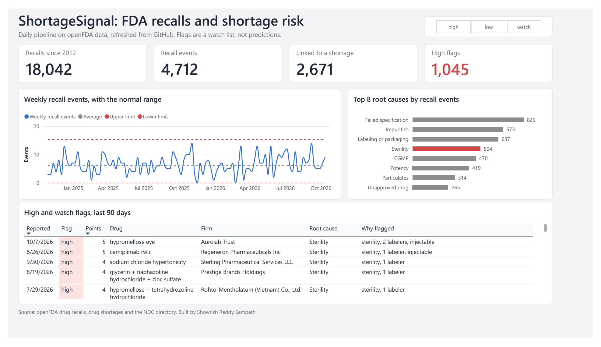
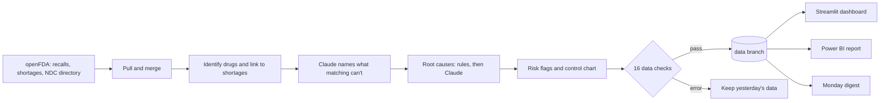

# ShortageSignal

A daily, automated pipeline on real FDA data that links drug recalls to drug shortages, checks its own data, uses Claude to fill the gaps that rules can't, and shows what it finds on a live dashboard.

**[Live dashboard](https://shortagesignal.streamlit.app)** · runs every day at 12:00 UTC on GitHub Actions · costs a fraction of a cent a day



## What it found

As of Nov 2, 2026. The dashboard always has the latest numbers.

- **Shortages after a recall are rare.** Of 3,639 drugs recalled since 2020, counting each drug in each recall event once, 45 (1.2%) were followed within a year by a shortage of the same drug that FDA still lists.
- **Injectables are the one sign that held up.** 1.9% of recalled injectables went short within a year, against 0.9% of everything else, and the gap shows up in both 2020-22 and 2023 on.
- **Sterility problems add nothing once injectables are accounted for.** Sterile injectables and other injectables both come in at 1.9%. Sterility only looked strong because most sterility recalls are injectables.
- **Drugs with few makers went short less often, not more.** The drugs only 1 or 2 companies list are mostly niche or compounded products, which FDA's shortage list rarely covers.
- **Followed doesn't mean caused.** 32 of the 45 rest on the loosest link, the same drug from any company, and 5 drugs that run short again and again, like fentanyl and atropine, make up 20 of them.
- **An earlier version got this wrong.** Counting recall events instead of drugs made sterility look 3 times riskier than average, and the first risk flag 4 times. Counting each drug on its own cut sterility to about 1.3 times, and that flag's high level to zero. The [decision log](docs/decision_log.md) has how it was caught and what changed.

## What it does

Every day, GitHub Actions runs the pipeline end to end:

1. **Pulls from openFDA:** the last 60 days of recalls, merged by recall number with a full edit history, a dated snapshot of the shortage list, and, once a week, the NDC directory.
2. **Identifies each recall's drug** from its NDC codes, FDA's own annotations and the product text, then **links recalls to shortage listings** at four strengths: the same package, the same product, the same drug and company, or the same drug.
3. **Asks Claude Haiku to name the drug** when matching can't. That takes recalls with a drug name from 56% to 83%, and a name is only used when Claude is fairly sure and the drug is known to exist.
4. **Tags each recall's root cause.** SQL rules tag 99%, and Claude tags the rest, limited to 12 categories by a tool schema.
5. **Flags each recall:** high when its drug is already on the shortage list, watch for an injectable. Every new flag is logged the day it's given, and the Monday digest checks the log against shortages that come later. It also charts weekly recall events against a normal range.
6. **Runs 16 data checks before saving anything.** Errors keep yesterday's data, and warnings flag the run.
7. **Saves every table to the `data` branch,** which the dashboard, the Power BI report and the Monday digest all read.



## See it

- **[The dashboard](https://shortagesignal.streamlit.app)** has recent risk flags, the weekly control chart, what follows a recall, and **Ask the data**, where Claude writes one read-only SQL query over the tables and answers from the rows, with the query shown. That tab is behind a passcode.
- **The Power BI report** is in [`reports/powerbi/`](reports/powerbi). Open `shortagesignal.pbip` in Power BI Desktop and click Refresh, and it pulls the latest data straight from GitHub.
- **The Monday digest** is posted as a GitHub issue labeled `digest`, with an Excel list of the items that need a person's look.

## How the AI was tested

Each of Claude's three jobs was scored against answers a person wrote: first on a 99-recall hand audit that everything was tuned on, then on 30 fresh recalls labeled blind.

| Job | First audit (tuned on) | Fresh labels |
|---|---|---|
| Root causes, rules | 99 of 99 | 18 of 20 |
| Root causes, Claude, on what the rules can't tag | not tested | 5 of 9 |
| Drug names, Claude, ignoring salts | 70 of 74 | 14 of 15 |
| Ask the data | 17 of 18 test questions | |

The fresh labels are the honest numbers, and the samples are small. [docs/ai_evals.md](docs/ai_evals.md) has the details, including the 9 drug labels that were fixed in the open and the chatbot's first live question that came back wrong.

## Built with

Python, SQL on DuckDB, Parquet, GitHub Actions, Claude Haiku through the Anthropic API with tool use, Streamlit, Power BI, openpyxl, pytest and ruff.

## Run it

Open it in **GitHub Codespaces** (Code, then Codespaces), and everything installs from `.devcontainer/`. Or install it locally with `pip install -e ".[dev]"`. Then:

```
git fetch origin data
git archive origin/data | tar -x -C data       # the latest data, into data/
pytest                                          # 124 tests
python -m shortagesignal.ingest                 # a full run, with Claude off
SHORTAGESIGNAL_DATA=local streamlit run app/streamlit_app.py
```

The [runbook](docs/runbook.md) has every other command, and what to do when something breaks.

## Docs

| Doc | What's in it |
|---|---|
| [Runbook](docs/runbook.md) | What runs when, keys and settings, rerunning a day, what each data check means and what to do |
| [Data dictionary](docs/data_dictionary.md) | Every file and column, built from the data itself |
| [AI evals](docs/ai_evals.md) | How Claude's three jobs were tested, and what the scores mean |
| [Limitations](docs/limitations.md) | What the data leaves out, where it can be wrong, how far the findings go |
| [Decision log](docs/decision_log.md) | Every choice and why, including the ones that were reversed |
| [Git workflow](docs/git_workflow.md) | Issues, branches, pull requests and CI |

## How the repo works

`main` is protected, and every change goes through an issue, a branch and a pull request that CI has to pass. The work is planned in four batches, each a milestone on the Issues tab.

```
src/shortagesignal/   the pipeline: ingest, identify, match, extract, tagging, risk, checks, digest, ask
sql/                  the root-cause rules and every analysis query
app/                  the Streamlit dashboard
reports/powerbi/      the Power BI project
audit/                the hand labels and every eval result
docs/                 the runbook, data dictionary, AI evals, limitations and decision log
tests/                the tests
.github/workflows/    the daily run, the weekly digest, and CI
```

## Disclaimer

Built on public openFDA data for analysis and learning. It isn't medical advice.

Built by Showrish Reddy Sampath · [LinkedIn](https://www.linkedin.com/in/showrish-reddy-sampath-b508a22a6) · [GitHub](https://github.com/Showrish)
